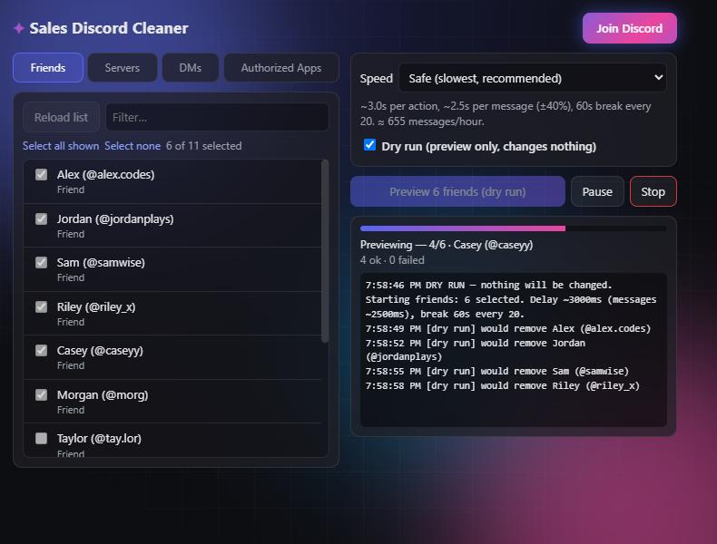

  

<h1 align="center">Sales Discord Cleaner</h1>

  Bulk-remove friends, leave servers, delete your DM messages and deauthorize apps, all from one menu. 
  <a href="https://discord.gg/rMkAf7tW9e"><b>Join the Discord</b></a> ·
  <a href="../../releases/latest"><b>Download</b></a>

  

> [!WARNING]
> Automating a user account breaks Discord's Terms of Service. Even on the slowest
> speed, Discord **can flag or disable your account**. Only use it on an account you're
> willing to risk. Deletions **cannot be undone**. You use this at your own risk.

## Features

- **Friends:** remove friends, cancel outgoing requests, ignore incoming ones, unblock users.
- **Servers:** leave servers in bulk. Servers you own are greyed out.
- **DMs:** delete **your own** messages in any DM or group DM, and optionally close the DM.
- **Authorized Apps:** revoke access for apps listed in Settings → Authorized Apps.
- **Dry run** (on by default): shows exactly what would happen without changing anything.
- **Anti-ban pacing:** randomized delays, regular breaks, automatic slow-down when Discord rate-limits you.
- **Pause / Stop** at any time. Jobs keep running after you close the menu.
- **100% local:** no servers, no tracking. Your session never leaves `discord.com`.

## Install

1. Download the latest **`sales-discord-cleaner-vX.Y.Z.zip`** from [Releases](../../releases/latest) and unzip it.
2. Open `chrome://extensions` (Edge: `edge://extensions`, Brave: `brave://extensions`).
3. Turn on **Developer mode** (top right).
4. Click **Load unpacked** and select the unzipped folder (the one containing `manifest.json`).
5. Open <https://discord.com/app>, log in, and **reload the tab once (F5)**.
6. Pin the extension from the puzzle-piece menu and click it.

**Updating:** download the new ZIP, replace the folder's contents, then click ↻ on the extension in `chrome://extensions`.

## How to use

1. Pick a tab: **Friends**, **Servers**, **DMs**, or **Authorized Apps**.
2. Click **Load list** and tick what you want. Use the filter and *Select all shown*.
3. For DMs, choose **Delete my messages** and/or **Close the DM**.
4. Pick a **Speed**.
5. Run it once with **Dry run** on and check the log.
6. Turn **Dry run** off, click **Start**, then click again within 4 seconds to confirm.

Keep the Discord tab open while a job runs. You can close the menu and reopen it to check progress.

## Speed settings

| Preset | Per action | Per message | Randomness | Breaks | ≈ Messages/hour |
|---|---|---|---|---|---|
| **Safe** (default) | ~3.0s | ~2.5s | ±40% | 60s every 20 | ~650 |
| Normal | ~1.8s | ~1.5s | ±35% | 30s every 40 | ~1,600 |
| Fast | ~0.9s | ~0.8s | ±25% | none | ~4,500 |
| Custom | you pick | you pick | you pick | you pick | — |

If Discord rate-limits a request, the extension waits as long as Discord asks and slows the rest of the job by 25%. Slower is always safer, and no setting is guaranteed safe.

## Limits

- Only **your own** messages can be deleted. The other person's side stays.
- System messages (call logs, "X joined the group") can't be deleted and are skipped.
- You can't leave servers you own. Transfer or delete them in Discord.
- Closing a **group DM** leaves the group.
- Chrome/Edge/Brave and other Chromium browsers only, not Firefox.

## Privacy & security

- `background.js` reads the `Authorization` header that the Discord web app already sends,
  and keeps it in `chrome.storage.session` (memory only, wiped when the browser closes).
- Only the script running on `https://discord.com` can read it, and it's only ever sent to
  `https://discord.com/api`.
- No analytics, no external requests. Read the code: it's about 1,200 lines in total.

**Never paste your Discord token anywhere, and only install this from the official repo.**

## Files

| File | What it does |
|---|---|
| `manifest.json` | Extension config |
| `background.js` | Captures the session header from Discord's own requests |
| `content.js` | API calls, job queue, pacing and rate-limit handling |
| `popup.html` / `popup.css` / `popup.js` | The menu |
| `icons/` | Extension icons |

## Disclaimer

This project is not affiliated with or endorsed by Discord Inc. "Discord" is a trademark
of Discord Inc. Provided as-is under the [MIT License](LICENSE).
